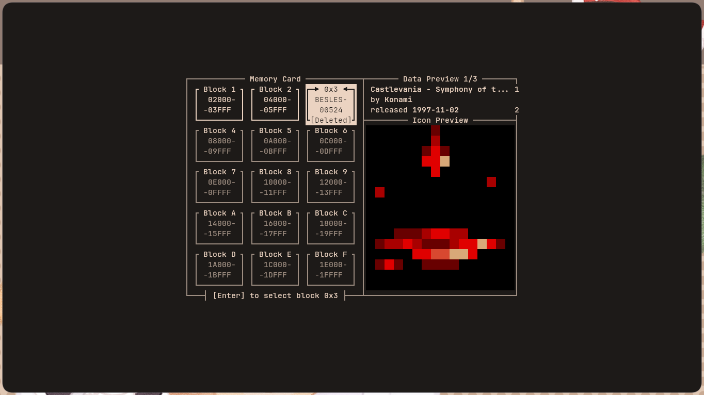
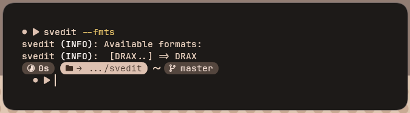

<div align="center">

# svedit
Global PlayStation© 1 save editor.  
Made with ♥ by quantum.


<br>
<sub><b>Figure 1</b>: Block picker example, with block <code>0x03</code> selected</sub>
</div>

## Features
### Intuitive UI, built with UX in mind
- `svedit` features an intuitive, easy to use, terminal interface.
- Quickly take a glance at any relevant metadata in your memory card, before diving into the save editor.
- It will also automatically download everything it needs to run on first startup.
- Additionally, `svedit` makes it super easy to get started with collaboration!

<div align="center">

<br>
<sub><b>Figure 2</b>: svedit downloading the PlayStation© game database</sub>
</div>

### Built for collaboration
- To see a list of currently supported formats, run `svedit --fmts`.
- If you're interested in helping out, scroll down to **Contributing**!
- After your entry gets accepted, your name will show up inside `svedit`, both in the terminal, and the
interface!

<div align="center">

<br>
<sub><b>Figure 3</b>: svedit's current (12/06/26) list of supported formats (Only 1, help expand it!)</sub>
</div>

## Installation
> [!note]
> Currently, `svedit` **doesn't come with prebuilt releases**.\
> This is planned for the (hopefully close) future!

> [!important]
> `svedit` only works on **Linux and Android**<sub>(through Termux)</sub>.
> 
> It *might* run on Windows through the **Windows Subsystem for Linux (WSL)**, but it is not tested!\
> A macOS release will depend solely on contributions or forks.

### Prerequisites
To install `svedit`, you'll need...
1. python 3.12+;
2. nuitka (arch: `yay -S nuitka`, deb: `sudo apt install nuitka`);
3. pyyaml (arch: `sudo pacman -S python-yaml`, deb: `sudo apt install python3-yaml`)

### Instructions
After installing the dependencies above...
1. Clone this repository;
2. Run the installation script inside:
    ```bash
    git clone https://github.com/QuantumsSources/svedit.git
    cd svedit
    python build.py
    ```
3. You can then delete the cloned repository.

## Contributing
Thank you for showing interest in contributing to `svedit`!\
If you've enjoyed using `svedit` and want to help out, there's two main ways to do so:

### 1. Providing Formats
`svedit` is, fundamentally, set up on a foundation of collaboration.\
As much as I'd love to spare you the time, I can't reverse engineer every single PSX save file format in the
world.

**That's where you come in!**

If you have the time, and the patience, you can just hop on whatever PSX game you like and
try to decipher its save file.

I highly recommend another tool of mine, built practically specifically for this purpose,
**selfhex**. You can download it [here](https://github.com/QuantumsSources/selfhex).

> [!note]
> `selfhex` has different requirements than `svedit`!\

I also recommend reading over the documentation of the XML structure `svedit` expects in `XML_DOCS.md`.

Once you've decided to start (again, **thank you**!), do this:
1. Fork this repository.
2. Clone your fork.
3. If your game's format ID isn't available yet (check with `svedit --fmts` or `svedit --fmt-available=<fmt>`),
you can start reverse engineering it.
4. After you're done (might take a while!) making the XML translation layer, push it to GitHub, start a pull
request, and wait for it to be accepted.

> [!note]
> If you'd like, you can add your GitHub name, etc... (no links, sorry!) in your XML file's root 
node as an attribute `contributor`. Like this:\
> ```xml
> <svedit pattern="..." generic="..." contributor="QuantumsSources"/>
> ```
> 
> I don't mind at all, I think it's a great way to show off your contribution!

> [!note]
> Even if contributions are low, I can't promise quick responses!\
> Thank you for your consideration, and please don't think I'm actively ghosting you!

### 1.1. Updating Formats
If you find a format that matches on one or more of the below criteria, you can also update it.

You can update a format if it is:
1. Hard to understand;
2. Weirdly formatted;
3. Incorrect;
4. Incomplete;

Doing so follows a similar pattern to creating a new format file:
1. Fork this repository.
2. Clone your fork.
3. Edit the file.
4. Start a pull request and wait for it to be accepted.

> [!note]
> If you'd like, you can also claim credit for updating a file, though obviously don't remove the original
author.\
> Here's an example:
> ```xml
> <svedit contributor="QuantumsSources, <you>" pattern="..." generic="..."/>
> ```
> The rule is exactly the same, you can put in your GitHub username, etc..., but no links!

### 2. Bug fixes and new features
Like most open-source projects, `svedit` accepts code contributions from others!\
If you know what you're doing, and know some Python, this is also a great way to help out! 

To help out with bugs or features, here's what you need to do:
1. Fork this repository.
2. Clone your fork.
3. Make your changes there, and test them out locally.
4. After you're done, push them to GitHub and start a pull request.

> [!note]
> Even if contributions are low, I can't promise quick responses!\
> Thank you for your consideration, and please don't think I'm actively ghosting you!

## Footnotes
> [!important]
> `svedit` is actively tested out, by me, on multiple terminals.
> 
> Here's what you can expect:
> 1. `kitty`: The one I use to develop `svedit`, best experience overall
> 2. `alacritty` / `konsole`: Also on par with `kitty`
> 3. `gnome-terminal`: You might experience occasional flickering, though nothing major.
> 4. `tty`: Functional *(-ish)*, though with frequent flickers and no RGB color
> 5. `cmd` / `powershell`: `svedit` is not tested on Windows or WSL.

> [!note]
> The icon for `svedit` is ~~stolen~~ borrowed from Sonic the Hedgehog 3.\
> Original sprite by SEGA and Sonic Team, with minimal edits by me.

<div align="center">
(woah, it's not so empty down here anymore...)
</div>